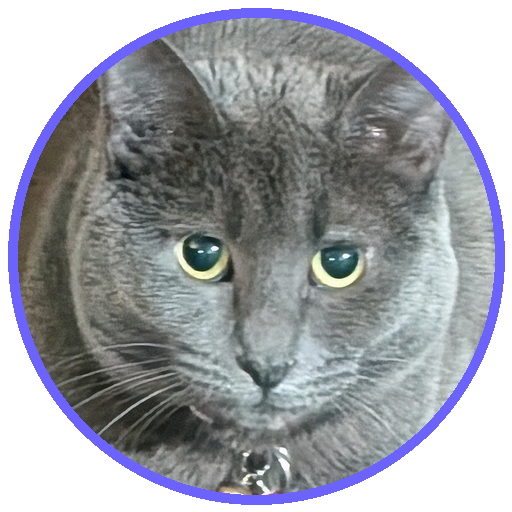
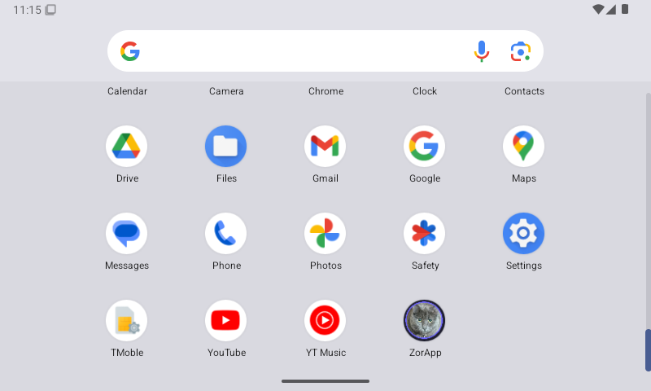

# ZorApp 🐾

<p align="center">
  
</p>

<p align="center">
  <strong>High-Glanceability Offline Image Viewer for Automotive Infotainment Displays & Modern Android</strong>
</p>

<p align="center">
  
  
  
  
  
</p>

---

## 📖 Overview

**ZorApp** is an air-gapped, privacy-focused image viewer built natively with modern **Jetpack Compose** and **Material 3**. Engineered specifically for in-vehicle center console screens (modeled after the 2016 Cadillac CTS 8.0" 800×480 WVGA display) while scaling responsively to high-density modern smartphones (e.g., Google Pixel 11 Pro XL).

---

## ✨ Features

- 🛡️ **100% Air-Gapped & Offline:** Complete privacy. Zero internet permissions (`android.permission.INTERNET` omitted) and zero external network calls.
- 🚗 **Automotive Ergonomics:** 48dp+ tactile touch targets, high-contrast dark theme, and glanceable typography designed for minimal cognitive load while parked or mounted in a vehicle.
- 👆 **Fluid Swipe & Zoom Gestures:**
  - **Horizontal Swipe Pager:** Smooth flick-to-swipe image carousel powered by `HorizontalPager` with native fling physics.
  - **Double-Tap to Zoom:** Smooth 200ms animated toggle between `1.0x` and `2.5x` zoom.
  - **Pinch-to-Zoom & Pan:** Multi-touch zoom up to `5.0x` with bounded panning.
  - **Gesture Contention Safety:** Automatically locks pager scrolling during zoom (`scale > 1.05f`) to prevent accidental page transitions while panning details.
- 🐾 **Smart Frame (On-Device AI Subject Framing):** 100% offline neural network (TensorFlow Lite EfficientDet-Lite0) detects cats, pets, and subjects in <30ms, automatically framing with safe headroom, Rule-of-Thirds eye-line placement, and body inclusion on wide automotive displays.
- 🖼️ **Full-Screen Immersion & Return to Menu:** One-tap borderless full-screen view with a dedicated tactile `← Return to Menu` button and 3-way mode cycling (`Smart Frame` ➔ `Fit` ➔ `Fill`).
- 📁 **Direct Storage Scanning:** Automatically detects and loads photos from `/sdcard/zorapp` and `/sdcard/zapp` across JPG, JPEG, PNG, and animated GIF formats. Includes standard system file picker fallback.
- 🐱 **Custom Cat Adaptive Launcher Icon:** Eye-catching feline silhouette with luminous irises, customized for Android adaptive icon safe zones and in-app header branding.

---

## 📸 Screenshots

### Smart Frame Comparison (Cadillac CTS 800×480)
| 🐾 Mode: Smart Frame (AI Focus) | 📐 Mode: Fit (Full Image) | 🔍 Mode: Fill (Center Crop) |
| :---: | :---: | :---: |
|  |  |  |
| **Protected ears**, Rule-of-Thirds eyes, loaf body & collar captured. | Uncropped original; 65% of screen wasted on black bars. | Blind zoom; chops off paws, collar, and bottom torso. |

### In-App UI & System Launcher
| App Drawer Launcher Icon | Full In-App Experience with Cat Badge |
| :---: | :---: |
|  |  |

---

## 🛠️ Tech Stack & Environment

- **Language:** Kotlin 2.0.21
- **UI Toolkit:** Jetpack Compose (BOM 2024.11.00) with Material 3
- **Image Pipeline:** Coil 3.x / Coil 2.7.0 with hardware acceleration & `GifDecoder` / `ImageDecoderDecoder`
- **Build System:** Gradle 8.11.1 + Android Gradle Plugin 8.7.2
- **JDK:** Eclipse Temurin JDK 21 LTS (`jdk-21.0.12.101-hotspot`)
- **Compatibility:** `minSdk 26` (Android 8.0 Oreo) up to `targetSdk 35` (Android 15)

---

## 🚀 Quick Start

### 1. Build from Terminal
```powershell
# Clone the repository
git clone https://github.com/knauerhase/ZorApp.git
cd ZorApp

# Assemble debug APK
.\gradlew.bat assembleDebug
```
The output APK is generated at `app/build/outputs/apk/debug/app-debug.apk`.

### 2. Run on Cadillac CTS Emulator (800×480 WVGA)
```powershell
# Launch the emulator with hardware acceleration
.\launch_cadillac_cts_emulator.bat

# Install ZorApp onto the running emulator
adb install -r app\build\outputs\apk\debug\app-debug.apk

# Launch the interactive display window
.\view_zorapp_screen.bat
```

---

## 📚 Documentation

- [PLAN.md](PLAN.md) — Comprehensive technical architecture, display hardware specifications, and phase tracking.
- [SESSION_NOTES.md](SESSION_NOTES.md) — Chronological engineering logs and architectural decisions.
- [SDKandTools.md](SDKandTools.md) — Complete environment audit, tool versions, paths, and rollback guides.

---

## 📄 License
This project is licensed under the Apache License 2.0.
